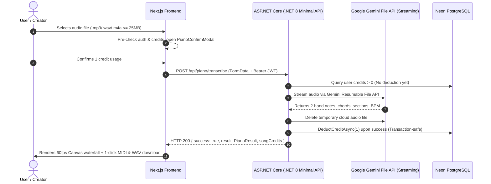
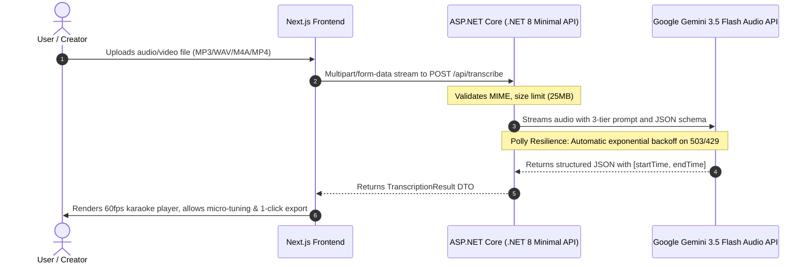

# Project Specification — LyricPhonics Core

> **Project Name:** LyricPhonics (AI Multimodal Audio Cover Transcription Engine)  
> **Architecture:** Clean Architecture Monorepo (ASP.NET Core .NET 8 LTS Backend + Next.js App Router Frontend)  
> **Author:** Thieu Viet Hoang  
> **Goal:** High-performance, open-source portfolio system demonstrating Clean Architecture, Polly Resilience, and modern Web Audio synchronization.  

---

## 🎯 1. Problem Statement & Value Proposition

### User Pain Points:
Singers and content creators looking to cover popular international songs (Chinese, Korean, Japanese, English, Thai) on TikTok or YouTube Shorts face significant barriers:
1. **Unreadable Source Scripts:** Inability to read non-Latin scripts (Hanzi, Hangul, Kanji).
2. **Unsingable Standard Romanization:** Standard Pinyin/Romaja lacks tonal cadence and rhythmic alignment, making singing sound robotic and disjointed.
3. **Missing Timing:** Common internet translations lack timestamps, leaving performers uncertain about verse entry and rests.

### LyricPhonics Solution:
- Users simply upload an audio/video file (MP3, WAV, M4A, MP4).
- The ASP.NET Core .NET 8 backend sends binary audio directly to **Google Gemini 3.5 Flash Audio API**, extracting a **3-tier structured response**:
  - **Tier 1 (Original Text):** Song lyrics in native script.
  - **Tier 2 (Phonetic Cover Text):** Cadence-accurate Vietnamese phonetic transcription with natural tone marks for immediate cover singing.
  - **Tier 3 (Translation Text):** Poetic Vietnamese translation capturing song emotion.
- A 60fps real-time synchronized karaoke workspace enables instant seek, micro-adjustments ($\pm 0.5s$), native speech pronunciation, and 1-click multi-format export (.TXT, .LRC, .SRT, Clipboard).
- **Piano Studio & MIDI Workspace:** Converts any song into an expressive 2-hand piano arrangement with 60fps Synthesia waterfall canvas, real-time chords, section chips, and browser-native export for Standard MIDI (.mid Type 1) and Audio (.wav).

---

## 🎹 2. Piano Studio & MIDI Architecture

---

## 🔄 3. End-to-End Lyrics Data Flow

---

## 🛡️ 3. Non-Functional Requirements (NFRs)

1. **High Performance:**
   - Real-time line tracking operates in $O(\log N)$ using binary search.
   - Backend streams binary audio via `StreamContent`, preventing large byte array memory buffers.
2. **Fault Tolerance & Resilience:**
   - Incorporates `Microsoft.Extensions.Http.Resilience` (Polly v8) for automatic retries with Exponential Backoff and Jitter.
3. **Zero Secret Leakage:**
   - API keys are strictly confined to server-side environment variables and gitignored settings files.
4. **Code Quality & Maintainability:**
   - Strict adherence to Clean Architecture with 4 distinct layers: Domain, Application, Infrastructure, Api.
