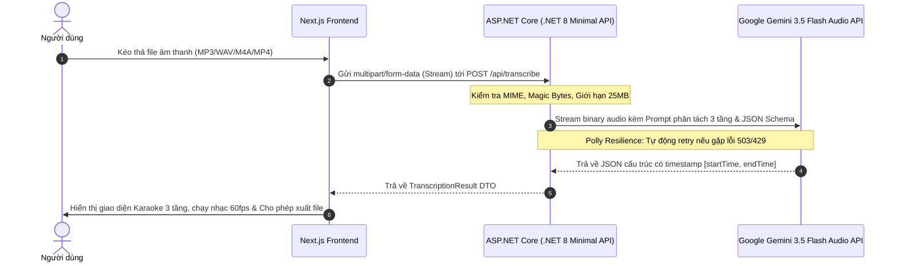

# PROJECT SPECIFICATION — LYRICPHONICS CORE (FULL-STACK MONOREPO)

> **Tên dự án:** LyricPhonics (Web Phiên Âm Lời Bài Hát Quốc Tế Để Cover)  
> **Kiến trúc:** Monorepo (ASP.NET Core .NET 8 LTS Backend + Next.js App Router Frontend)  
> **Tác giả:** Thieu Viet Hoang  
> **Mục tiêu:** Dự án mã nguồn mở thực chiến chuẩn Clean Architecture phục vụ luyện tập C# .NET và tạo lợi thế cạnh tranh phỏng vấn kỹ thuật.  

---

## 🎯 1. BÀI TOÁN & GIÁ TRỊ CỐT LÕI (VALUE PROPOSITION)

### Nỗi đau của người dùng (User Pain Points):
- Rất nhiều người yêu thích ca hát muốn cover các ca khúc tiếng Trung, Hàn, Nhật, Anh, Thái trên TikTok / YouTube Shorts nhưng gặp rào cản lớn:
  1. **Không biết đọc chữ gốc** (chữ Hán/Hanja/Kana).
  2. **Pinyin / Romaja truyền thống khó hát:** Phiên âm quốc tế không mang thanh điệu và ngữ âm tự nhiên của người Việt, khiến câu hát bị gượng gạo, lệch phách.
  3. **Không khớp nhịp nhạc:** Các bản dịch lời trên mạng không có mốc thời gian (timestamp), người hát không biết lúc nào vào câu, lúc nào ngắt nghỉ.

### Giải pháp của LyricPhonics:
- Người dùng chỉ cần tải lên file bài hát (MP3, WAV, M4A, MP4).
- Hệ thống backend .NET 8 kết nối **Gemini 3.5 Flash Multimodal Audio** tự động nghe và phân tích bài hát theo nhịp phách, trả về cấu trúc **3 tầng chuẩn xác**:
  - **Tầng 1:** Lời bài hát bằng chữ gốc.
  - **Tầng 2:** Phiên âm tiếng Việt bồi **chuẩn khẩu hình và thanh điệu** để người Việt nhìn vào là hát cover được ngay lập tức.
  - **Tầng 3:** Bản dịch nghĩa tiếng Việt vắn tắt theo cảm xúc bài hát.
- Tích hợp trình phát nhạc Karaoke đồng bộ mượt mà ở tần số 60fps kèm bộ công cụ xuất file 1-click (.TXT, .LRC, .SRT, Clipboard).
- Tính năng **nghe phát âm chuẩn bản xứ** (Native Speech) giúp người hát luyện chuẩn từng âm tiết.

---

## 🔄 2. LUỒNG DỮ LIỆU ĐẦU CUỐI (END-TO-END FLOW)

---

## 🛡️ 3. YÊU CẦU PHI CHỨC NĂNG (NON-FUNCTIONAL REQUIREMENTS)

1. **Hiệu năng cao:**
   - Tra cứu câu hát theo mili-giây đạt độ phức tạp $O(\log N)$ bằng thuật toán Binary Search.
   - Backend stream trực tiếp file âm thanh qua `StreamContent`, không buffer toàn bộ vào RAM server.
2. **Kháng lỗi (Resilience):**
   - Tích hợp `Microsoft.Extensions.Http.Resilience` (Polly v8) để tự động retry có độ trễ lũy tiến (Exponential Backoff with Jitter) khi AI API quá tải.
3. **Bảo mật tuyệt đối:**
   - Cách ly 100% `GEMINI_API_KEY` ở backend, không bao giờ lộ ra frontend hay commit lên Git.
4. **Mã nguồn sạch & Chuẩn phỏng vấn:**
   - Tuân thủ Clean Architecture 4 tầng.
   - Comment chi tiết bằng tiếng Việt có dấu về các nguyên lý OOP, SOLID, Design Pattern và cú pháp C# .NET 8.
