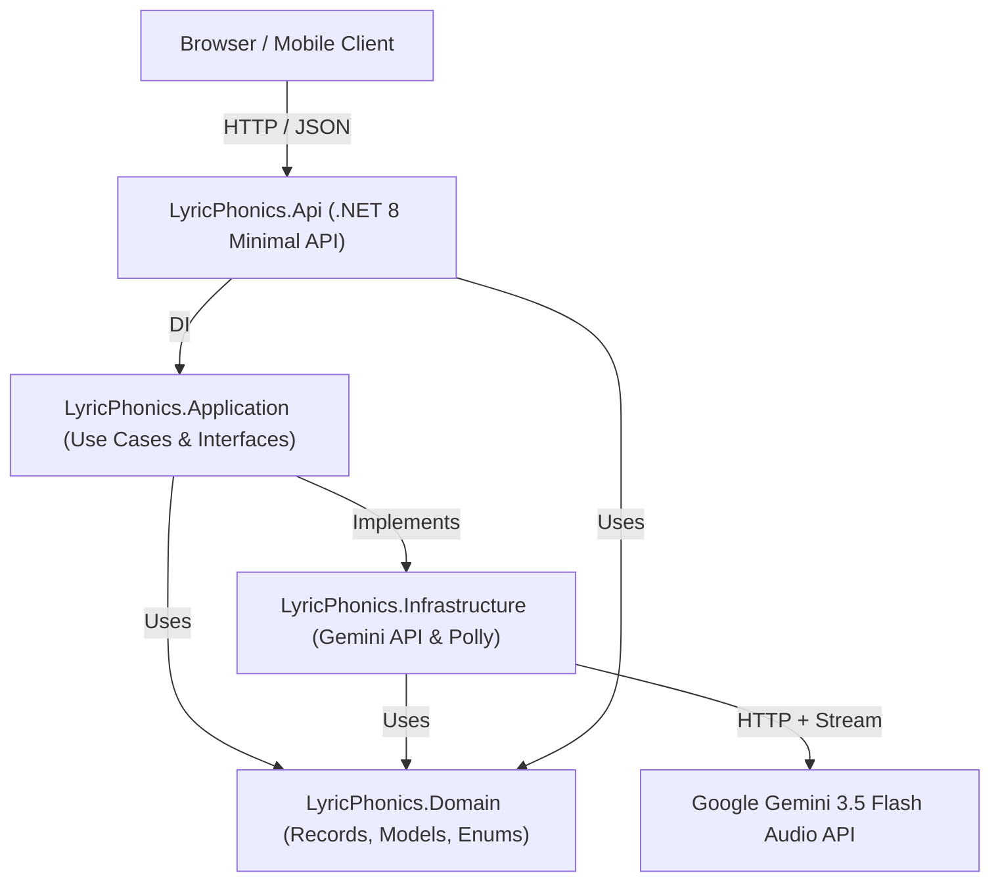

# TECHSTACK.MD — DANH MỤC CÔNG NGHỆ VÀ KIẾN TRÚC MONOREPO

> **Dự án:** LyricPhonics (Full-Stack Monorepo: C# .NET 8 LTS + Next.js App Router)  
> **Cập nhật:** 2026-10-17  
> **Phiên bản:** v0.3.0  

---

## 🏛️ KIẾN TRÚC TỔNG THỂ (CLEAN ARCHITECTURE MONOREPO)



---

## ⚙️ BACKEND TECH STACK (.NET 8 LTS)

| Thành phần | Công nghệ / Thư viện | Phiên bản | Mục đích & Điểm nhấn phỏng vấn |
| :--- | :--- | :--- | :--- |
| **Runtime & SDK** | **.NET 8 LTS (C# 12)** | `net8.0` | Bản hỗ trợ dài hạn (Long Term Support), hiệu năng đỉnh cao, AOT-ready. |
| **API Framework** | **ASP.NET Core Minimal APIs** | 8.0 | Khởi động siêu nhanh, cú pháp tinh gọn, benchmark hiệu năng vượt xa Controller truyền thống. |
| **Kiến trúc** | **Clean Architecture** | 4 Tầng | Phân tách trách nhiệm (SoC): Domain $\to$ Application $\to$ Infrastructure $\to$ Api. |
| **Fault Tolerance** | `Microsoft.Extensions.Http.Resilience` | 8.x | Polly v8 tích hợp sẵn: Exponential Backoff, Retry mã 503/429, Timeout, Circuit Breaker. |
| **Tài liệu API** | **Swashbuckle.AspNetCore (Swagger)** | 6.x | Tự động sinh giao diện OpenAPI/Swagger UI kiểm thử trực tiếp trên trình duyệt. |
| **Serialization** | `System.Text.Json` | Native 8.0 | Strong typing, zero-allocation serialization, loại bỏ hoàn toàn `Newtonsoft.Json`. |
| **Testing** | **xUnit + FluentAssertions + Moq** | Latest | Bộ 3 tiêu chuẩn vàng của kiểm thử tự động trong các dự án .NET doanh nghiệp. |

---

## 💻 FRONTEND TECH STACK (NEXT.JS)

| Thành phần | Công nghệ / Thư viện | Phiên bản | Mục đích |
| :--- | :--- | :--- | :--- |
| **Framework** | **Next.js (App Router)** | ^14.2 | Server & Client Components, routing linh hoạt. |
| **Ngôn ngữ** | **TypeScript Strict** | ^5.x | Strict mode, zero `any`, đảm bảo type-safety hoàn hảo. |
| **Giao diện** | **Tailwind CSS + Lucide Icons** | ^3.4 / ^0.450 | UI Cyberpunk hiện đại, responsive, icon âm nhạc trực quan. |
| **Audio Sync** | **HTML5 Audio + rAF** | Native | Vòng lặp `requestAnimationFrame` 60fps đồng bộ highlight câu hát mượt mà. |
| **Speech** | **Web Speech Synthesis API** | Native | Phát âm chuẩn giọng bản xứ (Bắc Kinh, Tokyo, Seoul...) không tốn phí API. |

---

## 📁 CẤU TRÚC THƯ MỤC CHUẨN (MONOREPO DIRECTORY MAP)

```text
LyricPhonics/
├── AGENTS.md                  # Quy tắc bắt buộc cho AI IDE & Lập trình viên
├── PROJECT_SPEC.md            # Đặc tả yêu cầu bài toán & User flow
├── TECHSTACK.md               # Bản đặc tả kỹ thuật này
├── TODO.md                    # Lộ trình Sprint & Công việc
├── CHANGELOG.md               # Nhật ký thay đổi chuẩn Keep a Changelog
├── TESTING_PLAN.md            # Chiến lược kiểm thử Backend & Frontend
├── .gitignore                 # Loại trừ bin/, obj/, node_modules, .env*, secrets
│
├── frontend/                  # GIAO DIỆN CLIENT (NEXT.JS)
│   ├── src/
│   │   ├── app/               # Next.js App Router (page.tsx, layout.tsx, globals.css)
│   │   ├── components/        # AudioDropzone, LyricView, AudioPlayerBar, ExportToolbar...
│   │   ├── hooks/             # useAudioPlayer (60fps rAF), useLyricSync
│   │   ├── lib/               # Export utilities (TXT, LRC, SRT, Clipboard), Speech, Time
│   │   └── types/             # Domain TypeScript interfaces
│   ├── package.json
│   └── tsconfig.json
│
└── backend/                   # MÁY CHỦ XỬ LÝ (ASP.NET CORE .NET 8 LTS)
    ├── LyricPhonics.sln       # Visual Studio Solution File
    │
    ├── src/
    │   ├── LyricPhonics.Domain/          # Core Entities, Records, Enums, DTOs
    │   ├── LyricPhonics.Application/     # Interfaces, Services, LRC parser, Binary search
    │   ├── LyricPhonics.Infrastructure/  # Gemini API Client, Polly Resilience, Logging
    │   └── LyricPhonics.Api/             # Minimal API Endpoints, Middleware, Swagger UI
    │
    └── tests/
        └── LyricPhonics.Tests/           # xUnit Unit & Integration Tests
```
